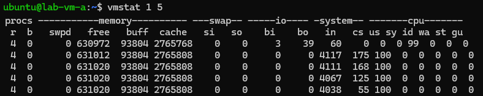
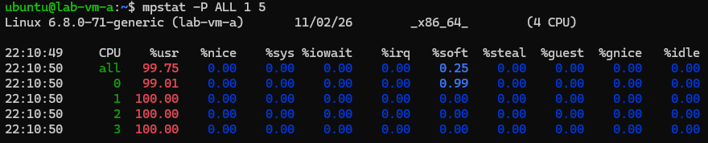
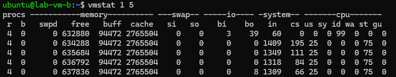
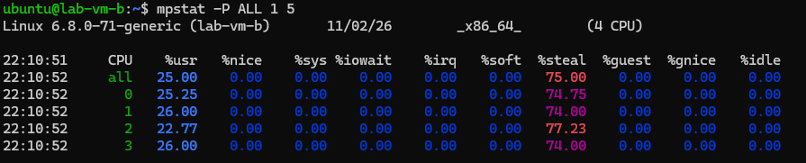

# CPU Steal: when your cloud VM is waiting for a CPU it was promised

*Part 1 of 3 — the hidden host-level causes of VM tail latency.*

## What it is

When you rent a VM with, say, 4 vCPUs, those vCPUs are **not** dedicated physical
cores. They are time-shares on the host's real cores, handed out by the
hypervisor's scheduler. Most of the time you don't notice — you get a core the
instant you ask. But two things break that:

- **Overcommit** — the provider has sold more vCPUs across all the VMs on that
  host than there are physical cores. Fine while everyone is mostly idle; painful
  when they aren't.
- **A noisy neighbour** — another tenant on the same host is burning every core.

When either happens, your vCPU becomes *runnable* — your code is ready to execute
— but the hypervisor has no free physical core to put it on. The time your vCPU
spends waiting in that queue is **CPU steal**.

> **Analogy:** you booked a taxi (your vCPU) and you're standing at the curb,
> ready to go (runnable). But every car is already carrying someone else. The
> time you spend waiting on the curb is steal. You did nothing wrong, your trip
> hasn't started, and the delay isn't on your meter — you're just waiting for a
> resource you were promised.

The important part: **your guest kernel can see this.** The hypervisor tells it
"you were ready but I couldn't schedule you," and Linux counts those cycles as
`%steal`. So steal is one of the few host-level problems a tenant can detect from
*inside* the VM, with no access to the host.

### Why it wrecks tail latency (P99), not just averages

Steal is **bursty**. It doesn't arrive as a smooth 5% tax — it clusters into
short spikes when a neighbour gets busy. Your *average* CPU time can look fine
while individual requests that happen to land during a steal burst wait tens of
milliseconds for a core. That's exactly the shape of the classic complaint:
"my app is randomly slow and I can't find any slow code." The slow code isn't
yours — it's the wait for hardware.

## How to determine it (from inside your VM, no host access)

Steal only appears **under load** — an idle VM shows 0% steal even on a terrible
host, because it isn't asking for a core. So generate a little demand, then look:

```bash
# watch the 'st' column (the LAST column) while something uses CPU
vmstat 1 5

# or the %steal column, per-CPU
mpstat -P ALL 1 3

# raw counter, no tools needed (field 9 of the cpu line = steal ticks since boot)
awk '/^cpu /{print "steal_ticks="$9}' /proc/stat
```

Reading the result:

- `st` / `%steal` **~0** under load → the host is giving you the CPU you ask for. Healthy.
- `st` / `%steal` **high** (e.g. 20–75%) under load → you are runnable but not
  getting scheduled. The host is the problem: overcommit, a noisy neighbour, or a
  provider-side cap on your VM.

**Steal vs. throttling — don't confuse them.** If `%steal` is high but your
cgroup's `nr_throttled` (in `cpu.stat`) is *not* rising, the cause is the host,
not your own CPU quota. High steal + zero throttling = host. (Throttling is
Part 2.)

**One honest caveat:** a CPU cap the *provider* places on your VM's QEMU process
shows up inside the guest as `%steal` too — indistinguishable from a noisy
neighbour without host access. Either way the conclusion for you is the same:
*the host is not giving you the CPU you are paying for.*

## How to simulate it (lab only — you need root on a KVM/QEMU host you own)

To reproduce steal on purpose — for a demo, a test, or to validate your
monitoring — you make the host unable to schedule a guest. Two ways:

### Method A — surgical (only the target VM is affected)

Pin **all** of one guest's vCPUs onto a **single** physical CPU. The VM still
thinks it has N cores, but the host only ever gives it one, so under load it is
constantly runnable-but-not-scheduled. Because it ties up just one physical CPU,
neighbours are essentially unaffected — this is the method to use on a shared
host.

```bash
# ON THE HOST (instance-00000d15 = the guest's libvirt domain; 23 = one pCPU)
for v in 0 1 2 3; do sudo virsh vcpupin instance-00000d15 $v 23 --live; done

# THEN INSIDE THE GUEST, create demand so the squeeze shows up:
stress-ng --cpu 4 --timeout 60s        # -> ~75% %steal in vmstat / mpstat

# UNDO (give the vCPUs all host CPUs back):
for v in 0 1 2 3; do sudo virsh vcpupin instance-00000d15 $v 0-47 --live; done
```

(On a Kolla/containerised libvirt, prefix with `sudo docker exec nova_libvirt`.)

### Method B — real noisy neighbour (every VM on the host is affected)

Oversubscribe the host's physical cores outright. Now the hypervisor physically
cannot serve everyone, and **all** co-located guests see steal rise together —
the genuine overcommit scenario.

```bash
# ON THE HOST itself — load larger than the core count:
stress-ng --cpu "$(nproc)" --cpu-load 100 --timeout 60s
```

> ⚠️ Method B degrades every tenant on the box. Only run it on a **dedicated,
> throwaway host**. For an article/demo, prefer Method A — it produces textbook
> steal on exactly one VM with zero collateral damage.

## Seeing it live: two identical VMs, side by side

Nothing makes steal click like watching two identical VMs react to the *same*
command. **VM A** sits on a healthy host. **VM B** sits on an oversubscribed one
(in the lab we forced this by pinning all of B's vCPUs onto a single physical
core — the same effect a noisy neighbour has). Both are 4-vCPU VMs. We run the
same three steps on each.

### VM A — the healthy baseline

**Step 1 — put load on all 4 vCPUs:**
```
stress-ng --cpu 4 --timeout 60s &
```

**Step 2 — watch steal with vmstat:**
```
vmstat 1 5
```


*Guide:* look at the **last column, `st`** — it stays at **0**. `us` (user) is
high and `id` (idle) ~0: VM A gets every cycle it asks for. Nothing stands
between it and the hardware.

**Step 3 — confirm with mpstat:**
```
mpstat -P ALL 1 5
```


*Guide:* the **`%steal`** column is ~0 and **`%usr`** is ~99. Healthy — the VM
owns its cores.

### VM B — the victim

Same VM spec, same commands.

**Step 1 — same load:**
```
stress-ng --cpu 4 --timeout 60s &
```

**Step 2 — vmstat:**
```
vmstat 1 5
```


*Guide:* now **`st` reads ~75**. VM B is just as eager to use CPU, but
three-quarters of the time it's parked waiting for a physical core the host can't
give it. `id` (idle) is still ~0 — it isn't idle, it's **blocked**.

**Step 3 — mpstat:**
```
mpstat -P ALL 1 5
```


*Guide:* **`%steal` ≈ 75**, **`%usr` ≈ 25**. The VM only gets to actually compute
a quarter of the time; the other three-quarters are stolen by the host.

### The punchline

Put the four shots side by side:

| metric | VM A (healthy) | VM B (victim) |
|---|---|---|
| `vmstat` → `st`      | 0    | ~75 |
| `mpstat` → `%steal`  | ~0   | ~75 |
| `mpstat` → `%usr`    | ~99  | ~25 |

Same spec, same command, same load. One runs at full speed; the other spends 75%
of its life waiting for a CPU it was promised. **Nothing inside VM B's OS or your
code is wrong — the bottleneck is one layer below, on the host.** That is CPU
steal, and you just proved it in two commands.

## What to do about it (if you're the tenant)

You cannot fix host overcommit from inside the guest. But you can act on the
diagnosis:

1. Confirm it's steal, not your own throttling (check `nr_throttled` stays ~0).
2. Capture `vmstat`/`mpstat` under load as evidence.
3. Ask your provider to migrate the VM to a less-loaded host, move to a
   **dedicated-CPU** instance type (no overcommit), or change provider.

---

*Next: Part 2 — cgroup CPU throttling, the slowdown you inflict on yourself.*
*See also `ARTICLE-COMMANDS.md` (all three problems, command-only) and `triage.sh`
(the paste-and-run diagnostic).*
